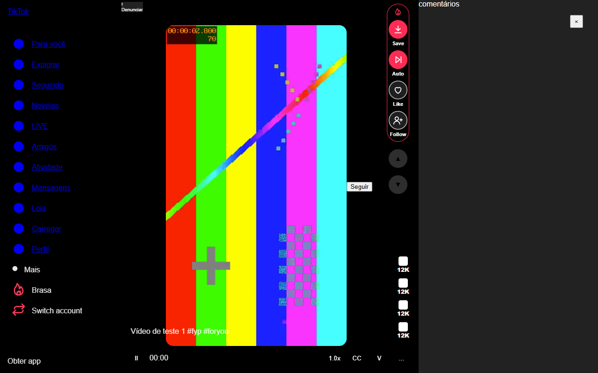
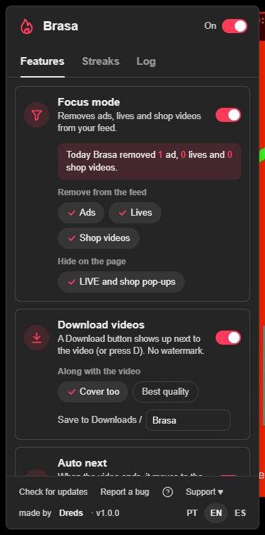
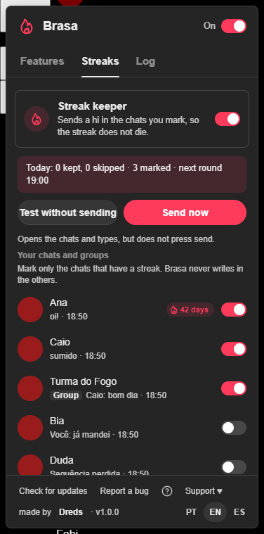

<div align="center">


# Brasa

**A cleaner TikTok on your computer, and your streaks kept alive.**
No ads, LIVE or shop videos in your feed, a streak keeper for the chats you choose, video download with sound and auto scroll. Free, no account, no server.


**Works on:** Chrome · Edge · Brave · Opera GX (desktop, tiktok.com)



</div>

---

## What it does

Brasa adds a **Brasa** item to TikTok's sidebar (below *More*). It opens a menu with one switch per feature and a line of explanation under each one.

- **Focus mode** *(on by default)*. Ads, LIVE and shop videos are taken out of **For You, Following and Friends** (and the *You may like* list) before TikTok draws them; if one slips through, Brasa skips it in under a second. LIVE and shop pop-ups over the page are hidden too. The sidebar is left exactly as TikTok made it: everything stays clickable. A counter shows what was removed today.
- **Streak keeper** *(does nothing until you mark a chat)*. In the **Streaks** tab you mark the chats and groups that have a streak 🔥. At 19:00 (and again at 22:00 as a backup; both times are yours to change) Brasa opens TikTok's Messages in its own minimized window and sends a short message, **only in the marked chats, and only if you haven't sent anything there that day**. Start with **Test without sending**: it opens the chats and types, but never presses send. The phrases are yours to edit. Optionally it keeps working with the browser closed (Chrome asks for the `background` permission).
- **Download videos** *(off by default)*. A **Save** button next to the video (or the **D** key) saves the video **with sound and without the watermark**, plus the cover and the photos of a carousel if you want them, into a folder of your choice inside Downloads.
- **Auto next** *(off by default)*. When the video ends, Brasa moves to the next one, once (photos after a few seconds you choose). It waits while the video is paused, while you type, or with the mouse on the player bar. TikTok's own *Auto scroll* switch is hidden, so you don't press it by accident.
- **Comments open** *(on by default)*. The comments panel opens next to the video on For You, Following and Friends. If you close it, it stays closed until you come back. On a video's own page it switches the right column from *You may like* to *Comments*.
- **Always open on For You** *(on by default)*. If TikTok opens on a lone video with *You may like* next to it (for example when the browser reopens the last tab), Brasa goes to For You through TikTok's own button. A video link you opened on purpose stays where it is.
- **Auto like and Auto follow** *(both off by default)*. Likes each video you open in the feed and follows whoever posted it, also when *Auto next* moves on. **They never undo anything:** Brasa only clicks when both the page and TikTok's own data say *not liked yet* / *not following yet*; if in doubt, it doesn't click. A rhythm and a daily limit keep it calm: one like every 3 s and up to 500 a day; one follow every 20 s and up to 150 a day.
- **Switch account**. An item right below Brasa in the sidebar: it asks first, uses TikTok's own *Log out* and then opens TikTok's log in screen, where you pick or enter the other account. Brasa never reads, stores or types a password.
- **Save, Auto, Like and Follow buttons** next to the video, in one block with the Brasa flame, so you can tell they come from the extension. They also work on a video opened from a profile, Explore or search (the panel with the X in the corner), photo carousels included.

<div align="center">

&nbsp;&nbsp;

</div>

> These screenshots are made by this repository's test suite ([`tests/prints-github.mjs`](tests/prints-github.mjs)) on a **simulated TikTok page** with a test video and made-up creators and chats: no account, no real video, no real conversation. Around Brasa's own interface, the real site looks different.

## Install

Brasa is not in a browser store: you install it from the release zip.

### Chrome, Edge, Brave and Opera GX

1. Download **`brasa-vX.Y.Z.zip`** from the [latest release](https://github.com/DredsGG/brasa/releases/latest) and unzip it into a folder you'll keep.
2. Open `chrome://extensions` (Edge: `edge://extensions`, Brave: `brave://extensions`, Opera GX: `opera://extensions`).
3. Turn on **Developer mode** and click **Load unpacked**. Pick the folder.
4. Open tiktok.com. A short tutorial opens on its own, and an install guide opens in a tab.

Opera GX: if the extension disappears after you close the browser, load it again (a known Opera issue with unpacked extensions).

### Updating

Brasa checks this repository's releases by itself: when the browser opens, every 30 minutes, and whenever you come back to a TikTok tab. When there is a new version, a notice appears in the middle of the page with what changed and an **Update** button.

- *Update* downloads the new zip. Unzip it **over the same folder**; Brasa notices within a minute and reloads itself (it waits if the streak keeper is sending right then).
- The **✕** only postpones the notice for an hour. A release marked **URGENTE** (a fix for a serious problem) shows the notice without ✕, and Brasa pauses until you update.

## Languages

Everything is in **Portuguese, English and Spanish**: the menu, notices, tutorial, *What's new*, the update notice and the install guide. The first time, it follows your browser's language (any other language falls back to English). Switch any time with **PT · EN · ES** in the menu footer; the choice is saved.

## Privacy

Short version: **nothing you watch or chat leaves your browser.** There is no Brasa server, no account, no analytics, no ads and no third-party service.

| | |
|---|---|
| **What it reads** (only on `tiktok.com`) | TikTok's own feed responses, kept **in memory only**, to take ads, LIVE and shop videos out and to find the video file when you press Save. On the Messages page: the chat list (name, picture, last message preview and time) and, for chats you open or mark, which days had messages from you and from the other side, and the streak count TikTok sends, so the streak keeper knows when to act. |
| **What it stores** (in your browser, `storage.local`) | Your settings; today's focus counter; the streak keeper's data (the chats it has seen, the ones you marked, your phrases, the last phrase sent per chat and today's results); today's auto like / auto follow count with the ids of the videos and profiles it acted on; the ids of the last 300 feed videos whose address it saw (only for *Always open on For You*, kept 14 days); the last 300 technical events of the log (event types, **no URLs, video text or chat content**); the update state. |
| **What it sends** | **1)** The update check: `GET api.github.com/repos/DredsGG/brasa/releases/latest` (GitHub sees your IP, as with any request). **2)** *Save* downloads the video from TikTok's own media servers, the same way the page plays it. Nothing else. |
| **What it does to your account** | Only what you turn on, always through TikTok's own buttons and with your session: the **streak keeper** sends messages in the chats you marked; **Auto like** and **Auto follow** like and follow; **Switch account** logs you out so you can log in to the other account. |
| **Report a bug** | Opens a new GitHub issue in your browser with a short diagnostic (version, browser, page type, which switches are on, the types of the last log events). You read it before you send it. |
| **Permissions** | `storage` (settings and data above), `alarms` (update checks and the streak keeper's times), `tabs` (find TikTok tabs and open Messages for the streak keeper), `scripting` (put a new version into tabs that are already open), `downloads` (videos and the update zip), `notifications` (the streak keeper's result after each round). Optional: `background` (only if you turn on *keep working with the browser closed*). Host access to `www.tiktok.com` and `api.github.com`. Nothing else. |

The code is here: read `extension/src/sw.js` (the update check and the downloads), `extension/src/page.js` (the only code that sees TikTok's responses) and `extension/manifest.json`.

## FAQ

**Will the streak keeper write in a chat I didn't mark?** No. It only opens the chats you marked, checks that you haven't sent anything there today, types one short phrase and sends it. Use *Test without sending* first to watch it work without sending anything.

**Are the automated features safe for my account?** They do exactly what your own clicks do, with your session, and they are off (or idle until you mark a chat) until you choose them. Whether TikTok is fine with automated messages, likes or follows is TikTok's call, not something this project can promise; that is why Auto like and Auto follow have a rhythm and a daily limit. Use them at your own discretion.

**Why do the ads come back after I turn focus mode off and on?** Brasa removes them from the next batch TikTok loads; what was already taken out only comes back with a page reload.

**Does it work on the TikTok app, mobile or Firefox?** No. Desktop Chrome, Edge, Brave and Opera GX only, on tiktok.com.

## How it works

- **Two worlds.** `src/page.js` runs in the page's own JavaScript world at `document_start` and only reads TikTok's feed responses (fetch and XHR) and filters them before the site draws them; it never sends anything. Everything else runs in the extension's isolated world and draws its interface in a shadow DOM, so TikTok's CSS can't leak in.
- **Measured, not guessed.** Every selector comes from measuring the live site (logged out) and TikTok's own code; the tests copy that DOM into a simulated page.
- **The streak keeper** runs from the service worker on alarms: it opens Messages in a minimized window of its own, follows strict rules (marked chat, nothing sent by you today, random pause between chats) and logs what it did.
- **No remote code.** No `eval`, no scripts loaded from a server; the update flow downloads a zip for *you* to unzip.
- **QR code** for the Support box: [qrcode-generator](https://github.com/kazuhikoarase/qrcode-generator) (MIT, Kazuhiko Arase), unchanged, in `extension/src/vendor/qrcode.js`. The Pix code is built locally in `src/apoio.js`.

## Tests

`tests/` loads Brasa as a real unpacked extension in Chromium (Playwright 1.63.0) with a new temporary profile each run, on a **simulated TikTok** (`mock.mjs`) and a **simulated Messages page** (`mock-dm.mjs`) that copy the DOM measured on the live site. No test ever sends a real message, likes, follows or logs out of a real account.

```
cd tests
npm i
node i18n-teste.mjs && node guarda-regras-teste.mjs
bash rodar.sh e2e-base e2e-foco e2e-guarda e2e-grupos e2e-baixar e2e-auto e2e-coment e2e-conta e2e-engaja e2e-entrada e2e-navegador recarga-e2e
```

Each must end with `TUDO PASSOU`. `ao-vivo.mjs` runs against the real tiktok.com (new profile, no login) and is for running by hand; `desempenho.mjs` measures CPU and memory over 10 minutes of the real feed. The **Test** workflow runs the first group on every push. See [`tests/README.md`](tests/README.md).

## Support

This project is free and always will be. If it helps you, you can support it on [GitHub Sponsors](https://github.com/sponsors/DredsGG) (one-time or monthly). 🇧🇷 In Brazil? Pix: `fa525dad-afca-4683-845d-eee7225a53e3`

## Disclaimer

Personal project, **not affiliated with or endorsed by TikTok or ByteDance**. TikTok changes its pages often, so a feature can stop working until Brasa is updated (use *Report a bug*). Downloads are for your personal use: respect the creators' rights.

## License

[MIT](LICENSE) · third-party notices in [THIRD-PARTY-NOTICES.md](THIRD-PARTY-NOTICES.md) · made by [André Miller Fleck (Dreds)](https://github.com/DredsGG)
